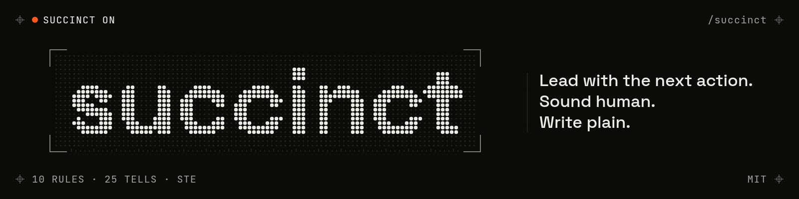

<p align="center"></p>

<p align="center">
  <a href="https://github.com/hayfever/succinct/actions/workflows/validate.yml"></a>
  <a href="LICENSE"></a>
  <a href="https://github.com/hayfever/succinct/releases/latest"></a>
</p>

An output style for coding agents, built for readers with ADHD: answer first, end on the next action, sound like a person, write plain English.

## Before

> Great question! Let me think about this. It's not just about the middleware, it's about trust. Your auth flow has a few moving pieces: the middleware, the token verification, and the cookie handling. Looking at `src/auth.ts`, the `verifyToken` function (around lines 42-58) seems to be using an older `jsonwebtoken` API — one approach would be to update the package. After making the change, you'd want to run the auth tests to confirm nothing breaks. Hope this helps! Let me know if you want to dig deeper.

## After

> Update `jsonwebtoken`, then edit `verifyToken` at `src/auth.ts:42` to match the current API.
>
> 1. Open `src/auth.ts`
> 2. Replace `verifyToken` (lines 42 to 58) with the current `jsonwebtoken` call
> 3. Run `npm test -- auth.spec.ts` to confirm the auth tests pass
>
> The auth flow has three parts: middleware, token verification, cookie handling. `verifyToken` uses the older `jsonwebtoken` API.

The rewrite keeps every claim from the original and adds none. That is the work the skill does, in three parts:

- **Shape.** Ten rules that shape every response for an ADHD reader: answer first, steps numbered, next action last, no "Hope this helps!"
- **Sound human.** 25 patterns that mark text as machine-made, from [Wikipedia: Signs of AI writing](https://en.wikipedia.org/wiki/Wikipedia:Signs_of_AI_writing). Strip them; keep every supported claim; never invent a fact.
- **Stay plain.** Simplified Technical English, the controlled writing standard behind aerospace maintenance docs: active voice, imperative steps, 20-word steps, one term per item, no semicolons.

The standard itself is free to download from ASD; this skill summarizes its Part 1 writing rules and does not reproduce the dictionary.

## Install

Claude Code:

```bash
claude plugin marketplace add hayfever/succinct
claude plugin install succinct@succinct
```

Codex:

```bash
codex plugin marketplace add hayfever/succinct --ref main
codex plugin add succinct@succinct
```

Every harness, with the command to type after install:

| Harness | Install | Type | INSTALL |
|---|---|---|---|
| Claude Code | see block above | `/succinct` | [Claude Code](INSTALL.md#claude-code) |
| Codex | see block above | `$succinct` | [Codex](INSTALL.md#codex) |
| OpenCode 2 | see INSTALL | `/succinct` | [OpenCode](INSTALL.md#opencode) |
| Pi | `pi install https://github.com/hayfever/succinct` | `/succinct` | [Pi](INSTALL.md#pi) |
| OMP | see INSTALL | `/succinct` | [OMP](INSTALL.md#omp) |
| Other agents | `npx skills add hayfever/succinct`, or paste the always-on snippet into the agent's rules file | `/succinct` | [Other agents](INSTALL.md#other-agents) |

## Turn it on and off

The five harnesses share one activation model:

1. `/succinct` turns the mode on for the current session (`$succinct` in Codex).
2. `/succinct on` turns it on and creates a `.succinct-always` flag file in the harness's configuration directory. Every new session starts on while the flag exists.
3. `/succinct off` turns it off and deletes the flag. Every new session starts off.
4. "stop succinct mode" or "normal mode" turns the mode off for the current session only.

In Pi and OMP, the footer shows `● SUCCINCT ON` while the mode is active, and `pi --succinct` starts one session with the mode on. Other agents keep the rules on through the [always-on snippet](INSTALL.md#always-on-snippet) in their rules file (`AGENTS.md`, Cursor user rules, `GEMINI.md`, and so on).

## Supported harnesses

| Harness | Loads | Status |
| --- | --- | --- |
| Claude Code | `.claude-plugin/plugin.json` | manifest checked in CI |
| Codex | `.codex-plugin/plugin.json` | loads in CI |
| OpenCode | `opencode.json` | loads in CI |
| Pi | `package.json` | loads in CI |
| OMP | `package.json` | loads in CI |
| Other agents | `skills/succinct/SKILL.md` or the always-on snippet | install documented |

Every row resolves to `skills/succinct/SKILL.md`, the canonical ruleset. "Loads in CI" means a job in `.github/workflows/validate.yml` installs the latest harness CLI and loads this checkout with no model request. For Claude Code, CI runs `claude plugin validate . --strict` on the manifests. Unit tests cover `/succinct on`, `/succinct off`, and the flag file in all five harnesses.

Edit only `skills/succinct/SKILL.md` and its `references/`. Run `python3 scripts/build_adapters.py` to update the version fields.

## The rules

The [canonical skill](skills/succinct/SKILL.md) is a 164-line core in three parts. Two reference files hold the full detail.

- Shape: ten rules that make an answer actable for a reader with ADHD, from the answer in line one and the next action in the last line to the five-item list cap. ([Part 1](skills/succinct/SKILL.md#part-1-shape-the-response))
- Sound human: 25 patterns that mark text as machine-made, strongest first, from [Wikipedia: Signs of AI writing](https://en.wikipedia.org/wiki/Wikipedia:Signs_of_AI_writing). The core carries the five strongest. The full catalog is in [references/patterns.md](skills/succinct/references/patterns.md). Keep every supported claim; never invent a fact. ([Part 2](skills/succinct/SKILL.md#part-2-sound-like-a-person))
- Write plain: Simplified Technical English, the controlled standard behind aerospace maintenance docs. Active voice, imperative steps, steps of 20 words or fewer, one term per item. Replacement lists are in [references/plain-english.md](skills/succinct/references/plain-english.md). ([Part 3](skills/succinct/SKILL.md#part-3-write-plain-simplified-technical-english))

### What it costs

The core `SKILL.md` is 164 lines, 1,378 words, and 2,080 tokens with the o200k tokenizer. That is about 1 percent of a 200,000-token context window, added once when the skill loads. The references load only when the model needs them: `patterns.md` is 2,046 tokens and `plain-english.md` is 1,141 tokens.

Before the split, the single file was 5,589 tokens. The up-front load is 63 percent smaller.

Every harness above loads the core file. The ASD standard is a free download; this skill summarizes its writing rules and does not reproduce the dictionary.

## Tune it

Fork the repo, edit `skills/succinct/SKILL.md`, then reinstall from your fork. Every harness in the table installs a fork the same way: swap `hayfever/succinct` for `owner/repo`.

Claude Code, as an example:

```bash
claude plugin uninstall succinct            # drop the upstream copy first:
claude plugin marketplace remove succinct   # fork and upstream share both names
claude plugin marketplace add <your-username>/succinct
claude plugin install succinct@succinct
```

Restart the harness, then invoke the skill again.

## Results

Paired eval of the shipped core on 17 cases, 3 trials per case, judged blind: baseline weighted 4.48, candidate weighted 4.75. The candidate carries no blocking finding and the baseline carries one. The candidate loaded only the core `SKILL.md`, with no reference file. Numbers, per-dimension means, earlier rounds, and the gate rule: [evals/RESULTS.md](evals/RESULTS.md).

## Credits

- [i-have-adhd](https://github.com/ayghri/i-have-adhd) by Ayoub G. (MIT), based on *The Adult ADHD Tool Kit* by J. Russell Ramsay and Anthony L. Rostain.
- [humanizer](https://github.com/blader/humanizer) by blader (MIT), patterns from [Wikipedia: Signs of AI writing](https://en.wikipedia.org/wiki/Wikipedia:Signs_of_AI_writing).
- [ASD-STE100 Issue 9](https://www.asd-ste100.org) by the ASD Simplified Technical English Maintenance Group (free download; summarized, not reproduced).

## License

MIT. Full third-party notices are in [THIRD_PARTY_NOTICES.md](THIRD_PARTY_NOTICES.md).
